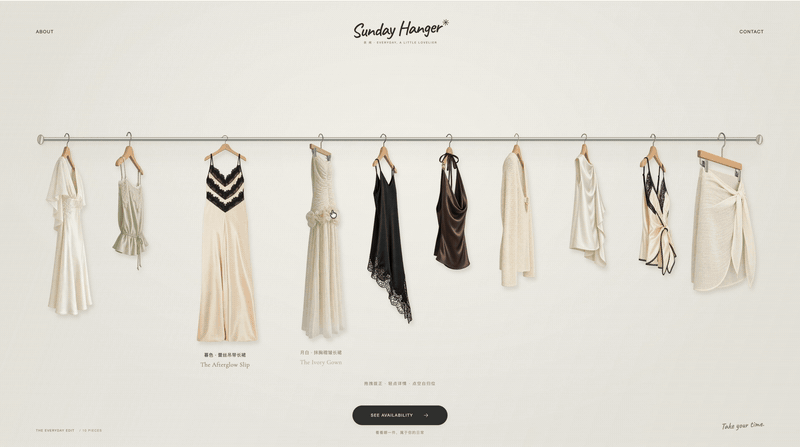

# 衣架购物页生成器 · Hanger Shopping Page

上传一款或多款服装正面照，让 AI 生成自然侧挂、正面悬挂图片，再制作带品牌设计的衣架购物交互单页。

**[在线体验 Demo](https://vivilin826.github.io/hanger-shopping-page/)** · **[下载 Skill ZIP](downloads/hanger-shopping-page-v1.zip)** · **[查看 Skill](hanger-shopping-page/SKILL.md)**

[](https://vivilin826.github.io/hanger-shopping-page/)

*动图来自实际制作的第二版页面录屏。点击动图可打开交互 Demo；演示包含 AI 生成的悬挂素材。*

## 客户只需提供照片

```text
用 $hanger-shopping-page 把我的服装正面照做成衣架购物页。
品牌、slogan、价格和配色暂时用默认，价格不展示。
```

如果已有店铺信息，也可以这样说：

```text
用 $hanger-shopping-page 制作我的衣架购物页。
品牌名：我的店铺
slogan：慢慢挑选喜欢的那一件
配色：暖米色
展示品名和实际价格。服装正面照已经上传。
```

Skill 会集中确认一次品牌名、slogan、价格、店铺入口与视觉偏好。回复“默认”即可继续，不需要客户逐步描述动效或提供侧挂图。

**正面原图 → 配对悬挂图 → 品牌版面 → 交互 HTML**

- 一款照片就能开始，多款按实际数量陈列，不复制服装凑数。
- 正面原图用于锁定款式，核对领口、袖型、衣长和花纹。
- 正挂和侧挂都包含完整木衣架，保留布料、吊带与木架的真实遮挡。
- 没有品牌时使用协调的演示设计；没有价格时隐藏，不编造价格或库存。

## 页面交互

| 操作 | 效果 |
| --- | --- |
| 悬停 | 显示品名，保持侧挂 |
| 按住拖拽 | 留在原架转正，木架先动、衣身与裙摆稍后跟随，两侧衣物让位 |
| 松手 | 轻微回摆后收稳，保留正面预览并停止循环动效 |
| 点空白 / Escape | 恢复侧挂全景 |
| 单独轻点 | 打开静止单品详情，支持切款、正面/侧挂切换和关闭返回 |
| 手机触摸 | 支持拖拽预览、轻点详情与切款 |

采用透明图片与 WebGL 网格动效、沿杆轮廓接触约束。无需准备 GLB 模型；这是悬挂交互的近似实现，不是完整三维布料仿真。无 WebGL 时保留图片交互回退。

## 安装与使用

1. 下载上方 ZIP，解压并保留完整的 `hanger-shopping-page/` 目录。
2. 将目录安装到支持 Skill 的 AI 编程工具中。Codex 本地 Skills 目录通常为 `~/.codex/skills/`；已有同名目录时先保留旧版。
3. 调用 `$hanger-shopping-page`，提供服装正面照片和想展示的店铺信息。

需要当前 AI 环境具备图片生成、文件读写和运行 Python 的能力。Skill 包含工作流程、提示词、前端模板与打包脚本；图片生成服务及其额度由使用环境提供。HTML 打包脚本只依赖 Python 3.9+ 标准库。

生成器会交付可离线打开的独立 HTML、正侧悬挂 PNG，以及可编辑源码和配置。已有合格配对图也可直接使用。

## 文件结构

```text
hanger-shopping-page/
├── SKILL.md
├── agents/openai.yaml
├── references/
│   ├── images.md
│   └── frontend.md
├── scripts/build_page.py
└── assets/frontend/
    ├── index.html
    ├── styles.css
    ├── app.js
    ├── rack-physics.js
    ├── cloth-mesh.js
    └── assets/

docs/
├── index.html       # 可交互示例
├── demo.gif         # README 演示动图
└── preview.png
```

前端几何配置和构建命令见 [接入约定](hanger-shopping-page/references/frontend.md)。展示、询款和店铺链接属于本 Skill 范围；真实支付、库存后台及客户项目的线上发布需另行配置。

## 验证范围

已检查一款、三款、十款配置的构建、单款布局、可选价格、拖拽与轻点区分、静止详情、停稳和资源内嵌。每次生成的新服装素材仍需对照原图检查；模板检查不等于所有客户图片都已通过视觉验收。

字体许可证随资源保留，见 [字体目录](hanger-shopping-page/assets/frontend/assets/fonts/)。
