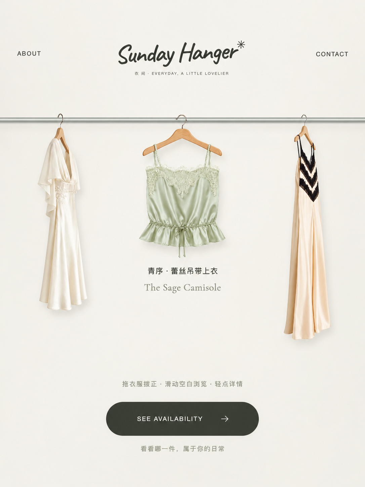

# 衣架购物页生成器 · Hanger Shopping Page

将服装正面照片制作成自然侧挂、正面悬挂素材与衣架购物交互单页。

**[手机样机 Demo](https://vivilin826.github.io/hanger-shopping-page/mobile-preview.html)** · **[下载 Skill ZIP](downloads/hanger-shopping-page-v1.zip)** · **[查看 Skill](hanger-shopping-page/SKILL.md)**

> **仅限学习和非商业使用。允许 Fork、修改和非商业再分发；未经书面授权禁止商用。** 查看 [完整许可证](LICENSE) / [中文许可说明](LICENSE.zh-CN.md)。

## 手机交互

- 首页展示三件侧挂服装。
- 拖动实际衣服，在原架拨正并居中，两侧露出相邻侧挂款。
- 底部横向浏览轴用于查看整排服装，不与衣服拖拽混淆。
- 轻点打开单品详情，支持切款、正面/侧挂切换。
- 详情空白处或 CLOSE 可关闭，箭头与其他操作按钮不会误关闭。

使用透明图片和 WebGL 网格实现悬挂与惯性效果，提供非 WebGL 图片回退。页面不包含支付、库存和订单后台。

## 下载与环境

- [Skill ZIP](downloads/hanger-shopping-page-v1.zip)：用于支持 Skill 的 AI 编程环境。
- [小红书工具 ZIP](downloads/shopping-hanger-xiaohongshu-mobile.zip)：平台上传产物。

生成素材需要所在环境具备图片生成、文件读写和 Python 能力；相关工具订阅与额度另行提供。新服装图片需核对款式及悬挂遮挡。

小红书音乐适配采用采样缓冲播放，平台兼容性尚待模拟器与 Android/iOS 真机验证。浏览器 Demo 的音乐播放结果不能作为小红书运行验收依据。

[3:4封面](docs/原页面封面-3比4-居中排版.png) · [1:1图标](docs/Shopping-Hanger-图标-1比1.png)

## 许可范围

本仓库代码、Skill和模板按自定义非商业学习许可提供。允许查看、学习、Fork、修改和非商业再分发，禁止未经书面授权的商业使用。

演示图片、服装素材、录屏、音乐及品牌标识不授予再利用许可；第三方字体遵循 [字体目录](hanger-shopping-page/assets/frontend/assets/fonts/) 内各自的 OFL 条款。
